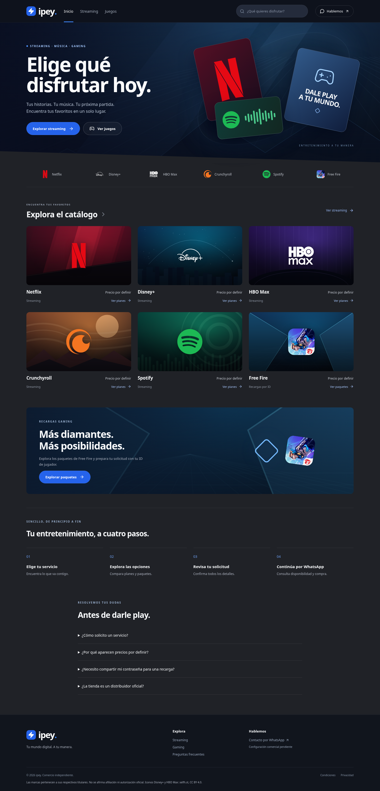
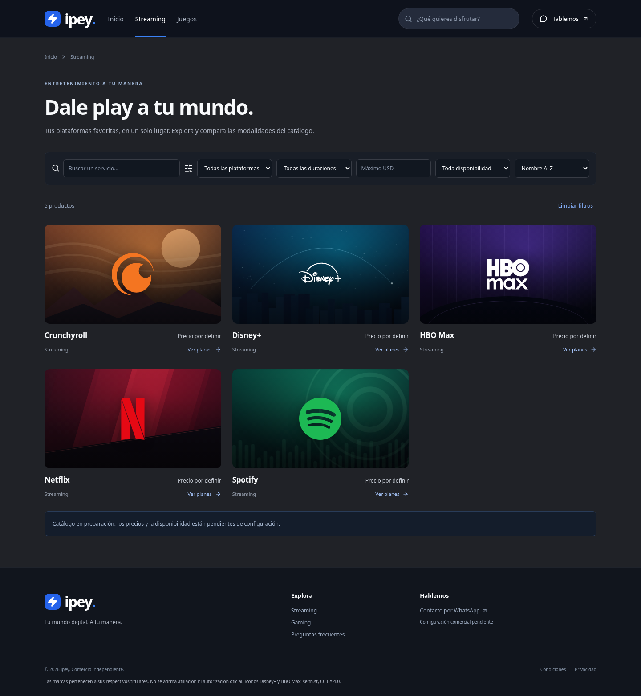
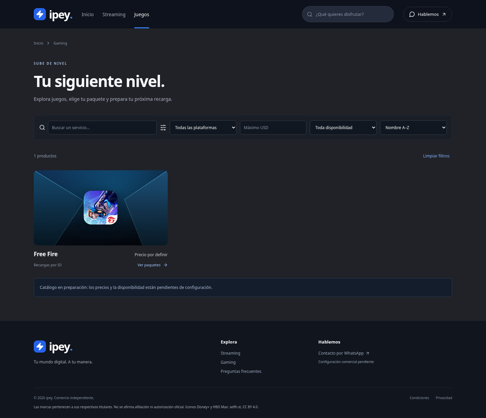

# Ipey · tienda digital

Catálogo responsive de streaming y gaming con React 19, TypeScript, Vite y Lucide. Funciona sin backend, registro ni pagos. El diseño usa fondos SVG originales y logotipos de los servicios guardados localmente; no carga imágenes ni fuentes de terceros en tiempo de ejecución.

## Desarrollo

Requisitos: Node.js 22.12 o superior (validado con 24.22.1), npm.

```sh
npm ci --cache /tmp/ipey-npm-cache
npm run dev
```

Ejecutar desde la raíz del repositorio. `npm run build` comprueba tipos y crea `dist/`; `npm run preview` sirve el resultado. `npm test` verifica las reglas comerciales. `npx playwright test --workers=2` verifica navegación y solicitudes en escritorio y móvil. Las pruebas usan Chromium del sistema cuando existe `/usr/bin/chromium`; también admiten `CHROMIUM_PATH` o el navegador instalado mediante `npx playwright install chromium`. Las pruebas de compra inyectan datos ficticios solo en el navegador de prueba, sin cambiar el catálogo publicado ni enviar mensajes.

## Estructura y edición

Los servicios usan imágenes de sus marcas guardadas localmente, tanto en las tarjetas como en el detalle. Consulta [procedencia y licencias de los logotipos](docs/LOGOTIPOS.md); el icono de Free Fire requiere revisar permisos antes de publicación pública. `src/ProductIdentity.tsx` centraliza las imágenes y muestra el nombre si falla su carga.

- `src/catalog.ts`: productos, variantes, características, duración en meses, diamantes, disponibilidad, precios, promociones, condiciones; y objeto `business` con nombre, moneda, contacto, WhatsApp y políticas.
- `src/commerce.ts`: validación, precios, promociones, resumen y enlaces oficiales `wa.me`.
- `src/main.tsx`: páginas, tarjetas, filtros, detalle, resumen accesible con dialog nativo, FAQ y navegación.
- `src/style.css`: sistema visual y adaptaciones móviles.
- `src/commerce.test.ts`, `e2e/`: pruebas de negocio y navegador.
- `public/favicon.svg`: símbolo de marca original; el encabezado usa el mismo concepto con Lucide.

Para habilitar una modalidad, configurar un precio numérico mayor que cero y `available: true`; el producto debe tener `active: true`. Cambiar condiciones y características con información comercial comprobada. La moneda se centraliza en `business.currency`; todos los precios usan esa moneda. `previousPrice` solo produce una promoción si supera al precio actual y el producto tiene `offer: true` y la variante está disponible. Los precios desconocidos son `null`. No hay descuentos o beneficios inventados. Desactivar un producto con `active: false`. Nuevos juegos usan `category: 'gaming'` y variantes con `diamonds`; siguen el flujo de ID de jugador. Para otros tipos de identificador será necesario ampliar su validación.

WhatsApp: sustituir `NUMERO_WHATSAPP_PENDIENTE` por el número internacional con código de país, solo dígitos, sin `+`, espacios o guiones (8–15 dígitos). El número no es una credencial. Mientras no sea válido, el contacto y el resumen muestran configuración pendiente. WhatsApp abre un borrador: el usuario confirma el envío. No hay API de envío ni verificación remota del ID de jugador.

## Publicación en GitHub Pages (pendiente de autorización)

La publicación pública **no está activada por este proyecto**. Subir código a `main` no ejecuta el despliegue. El workflow `.github/workflows/pages.yml` tiene únicamente un disparador manual y requiere confirmar la opción `publicar`.

Una vez que el propietario autorice expresamente la publicación:

1. En el repositorio, abrir Settings → Pages y elegir GitHub Actions como origen.
2. En Actions, elegir **Publicar en GitHub Pages (manual)** → Run workflow, seleccionar `main` y marcar `publicar`.
3. El workflow instala con `npm ci`, ejecuta las pruebas comerciales, compila, sube `dist/` y despliega en el entorno `github-pages`.
4. Obtener la URL real del resultado del despliegue; abrir Inicio, Streaming y Juegos, recargar sus rutas y comprobar recursos y consola.
5. Solo después de verificar esa URL, agregar al inicio de este README un enlace destacado **Ver la web** con la dirección real y guardar el cambio en `main`.

No se requiere añadir credenciales al código. El workflow usa el `GITHUB_TOKEN` temporal administrado por Actions y permisos limitados al despliegue. La activación de Pages necesita permisos administrativos del repositorio; ejecutar el workflow necesita permisos de Actions. No se cambia la visibilidad del repositorio.

`base: './'` y rutas hash (`#/streaming`, `#/juegos`, `#/producto/netflix`) permiten recursos relativos y recargas bajo `/ipey/` sin reglas de reescritura. El contenido compilado se ha verificado localmente bajo ese prefijo; eso no equivale a verificar una URL pública.

## Presentación

La interfaz toma como referencia las capturas de Instant Gaming aportadas por el usuario: banner panorámico, cabecera fija, portadas horizontales y nombre/precio debajo. Se conserva la paleta negra, gris y azul. La franja de servicios permite abrir cada producto. Las tarjetas muestran el precio solo cuando la variante se puede contratar y las ofertas aparecen únicamente si hay promociones válidas. Los fondos de `public/art/` son ilustraciones vectoriales originales del proyecto; no son material oficial de las plataformas.

## Capturas reales

Capturas generadas con Chromium a 1440 × 1000 y 390 × 844 desde la compilación de producción, sin alterar el catálogo. Se incluyen completas en `docs/capturas/`.

### Inicio



[Ver Inicio en móvil](docs/capturas/inicio-movil.png)

### Streaming



[Ver Streaming en móvil](docs/capturas/streaming-movil.png)

### Juegos



[Ver Juegos en móvil](docs/capturas/juegos-movil.png)

Para regenerarlas, en una terminal ejecutar `npm run build` y `npm run preview -- --port 4173 --base /ipey/`; en otra, `npm run screenshots`. Puede ajustarse `CAPTURE_URL` si cambia el servidor y `CHROMIUM_PATH` para otro ejecutable. Sin Chromium del sistema, instalar el navegador con `npx playwright install chromium`.

## Validación

- `npm run build`: TypeScript y compilación de producción.
- `npm test`: 6 pruebas comerciales.
- `npm run test:e2e`: 8 pruebas de navegador, repartidas entre escritorio y tamaño móvil; búsquedas, filtros, navegación, planes, validación del ID, resumen y enlace WhatsApp.
- `npm run screenshots`: verifica Inicio, Streaming y Juegos, recarga directa de rutas bajo `/ipey/`, número esperado de productos y carga de imágenes y ausencia de errores JavaScript antes de guardar las seis capturas.

No se envían mensajes de WhatsApp en las pruebas. La prueba de contratación usa datos ficticios aislados; los precios y el número publicados siguen pendientes. La emulación móvil en Chromium no sustituye pruebas en dispositivos físicos Android o iPhone.

## Antes de abrir las ventas

Completar precios, moneda, modalidades autorizadas, disponibilidad, características, región/compatibilidad, plazos, entrega, cancelaciones, reembolsos, identidad y contacto del responsable, privacidad y número de WhatsApp. Revisar el uso comercial de las plataformas. La tienda no afirma afiliación oficial. No se guardan pedidos ni IDs en almacenamiento del navegador o servidor; al continuar a WhatsApp el usuario comparte el resumen con ese servicio. Ajustar políticas al negocio y jurisdicción antes de vender.
