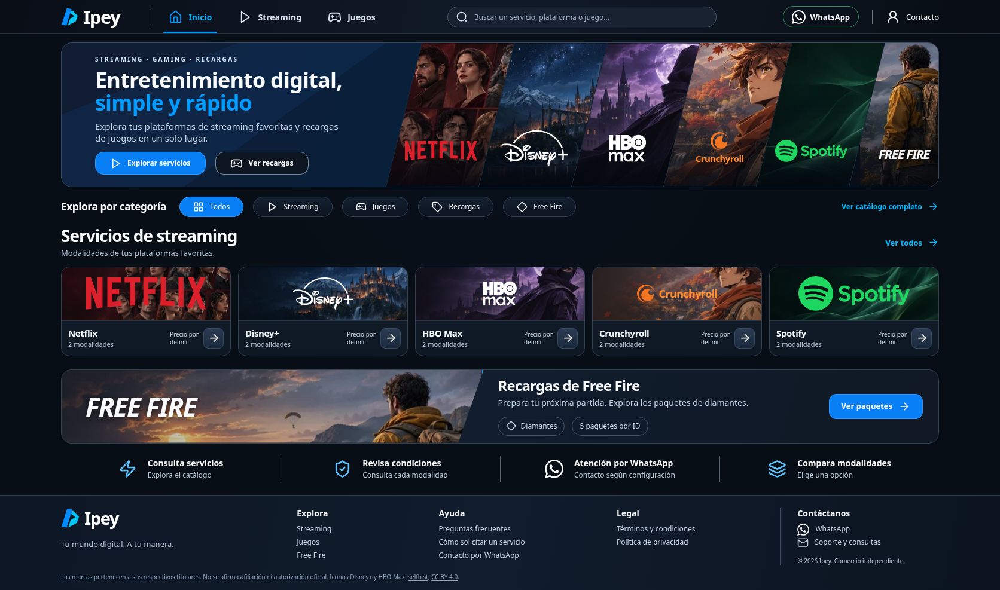

# Ipey · tienda digital

Catálogo responsive de streaming y gaming con React 19, TypeScript, Vite y Lucide. Funciona sin backend, registro ni pagos. El diseño usa ilustraciones originales y logotipos de los servicios guardados localmente; no carga imágenes ni fuentes de terceros en tiempo de ejecución.

Esta rama contiene la reconstrucción basada exclusivamente en las dos nuevas referencias. [Entrega, comparación visual y capturas](docs/RECONSTRUCCION-REFERENCIAS.md). Preparada para revisión; no solicita un despliegue.

## Desarrollo

Requisitos: Node.js 22.12 o superior (validado con 24.22.1), npm.

```sh
npm ci --cache /tmp/ipey-npm-cache
npm run dev
```

Ejecutar desde la raíz del repositorio. `npm run build` comprueba tipos y crea `dist/`; `npm run preview` sirve el resultado. `npm test` verifica las reglas comerciales. `npx playwright test --workers=2` verifica navegación y solicitudes en escritorio y móvil. Las pruebas usan Chromium del sistema cuando existe `/usr/bin/chromium`; también admiten `CHROMIUM_PATH` o el navegador instalado mediante `npx playwright install chromium`. Las pruebas de compra inyectan datos ficticios solo en el navegador de prueba, sin cambiar el catálogo publicado ni enviar mensajes.

## Estructura y edición

Los servicios usan imágenes de sus marcas guardadas localmente, tanto en las tarjetas como en el detalle. Consulta [procedencia y licencias de los logotipos](docs/LOGOTIPOS.md). `src/ProductIdentity.tsx` centraliza las imágenes y muestra el nombre si falla su carga. Free Fire utiliza el nombre tipográfico y una ilustración original; el PNG de licencia no confirmada deja de cargarse.

- `src/catalog.ts`: productos, variantes, características, duración en meses, diamantes, disponibilidad, precios, promociones, condiciones; y objeto `business` con nombre, moneda, contacto, WhatsApp y políticas.
- `src/commerce.ts`: validación, precios, promociones, resumen y enlaces oficiales `wa.me`.
- `src/main.tsx`, `src/App.tsx`: entrada, composición de páginas y rutas.
- `src/hooks/useStore.ts`: estado único de navegación, búsqueda, filtros y ordenación.
- `src/hooks/usePresentation.ts`, `src/layouts/StoreLayout.tsx`: cambio de presentación desde 1024 px sin desmontar el contenido ni perder el ID o plan seleccionado.
- `src/components/desktop/`, `src/components/mobile/`: header, hero, categorías, banner y footer de cada referencia; controles propios de cada presentación.
- `src/components/shared/`, `src/data/presentation.ts`: tarjetas, marcas, recursos, FAQ, resumen y contenido común.
- `src/pages/`: Inicio, catálogo, detalle y páginas informativas.
- `src/styles/`: tokens, base, componentes compartidos, páginas y composición independiente de escritorio/móvil.
- `src/commerce.test.ts`, `e2e/`: pruebas de negocio y navegador.
- La identidad vuelve a ser Ipey, con una marca vectorial original compartida. El resto de la configuración comercial permanece pendiente.

Para habilitar una modalidad, configurar un precio numérico mayor que cero y `available: true`; el producto debe tener `active: true`. Cambiar condiciones y características con información comercial comprobada. La moneda se centraliza en `business.currency`; todos los precios usan esa moneda. `previousPrice` solo produce una promoción si supera al precio actual y el producto tiene `offer: true` y la variante está disponible. Los precios desconocidos son `null`. No hay descuentos o beneficios inventados. Desactivar un producto con `active: false`. Nuevos juegos usan `category: 'gaming'` y variantes con `diamonds`; siguen el flujo de ID de jugador. Para otros tipos de identificador será necesario ampliar su validación.

WhatsApp: sustituir `NUMERO_WHATSAPP_PENDIENTE` por el número internacional con código de país, solo dígitos, sin `+`, espacios o guiones (8–15 dígitos). El número no es una credencial. Mientras no sea válido, el contacto y el resumen muestran configuración pendiente. WhatsApp abre un borrador: el usuario confirma el envío. No hay API de envío ni verificación remota del ID de jugador.

## Publicación en GitHub Pages

GitHub Pages está configurado para desplegar con Actions. Las ediciones normales de código en `main` no ejecutan el despliegue. El workflow `.github/workflows/pages.yml` permite dos solicitudes explícitas: ejecutarlo desde la interfaz marcando `publicar`, o modificar `.github/pages-publication.json` en un commit dirigido a `main`. Cambiar ese archivo solicita publicar la revisión completa de ese commit.

Una vez que el propietario autorice expresamente la publicación:

1. En el repositorio, abrir Settings → Pages y elegir GitHub Actions como origen.
2. En Actions, elegir **Publicar en GitHub Pages (manual)** → Run workflow, seleccionar `main` y marcar `publicar`.
3. Como alternativa desde Codex, tras la autorización del propietario y las verificaciones, actualizar `requested_at` y `reason` de `.github/pages-publication.json`, incluir los cambios aprobados en un commit y subirlo a `main`. La modificación de ese archivo dispara la publicación sin usar la API de GitHub.
4. El workflow instala con `npm ci`, ejecuta las pruebas comerciales, compila, sube `dist/` y despliega en el entorno `github-pages`.
5. Obtener la URL real del resultado del despliegue; abrir Inicio, Streaming y Juegos, recargar sus rutas y comprobar recursos y consola.
6. Solo después de verificar esa URL, agregar al inicio de este README un enlace destacado **Ver la web** con la dirección real y guardar el cambio en `main`.

No se requiere añadir credenciales al código. El workflow usa el `GITHUB_TOKEN` temporal administrado por Actions y permisos limitados al despliegue. La activación de Pages necesita permisos administrativos del repositorio; ejecutar el workflow necesita permisos de Actions. No se cambia la visibilidad del repositorio.

`base: './'` y rutas hash (`#/streaming`, `#/juegos`, `#/producto/netflix`) permiten recursos relativos y recargas bajo `/ipey/` sin reglas de reescritura. El contenido compilado se ha verificado localmente bajo ese prefijo; eso no equivale a verificar una URL pública.

## Presentación

Las dos imágenes adjuntas más recientes sustituyen las decisiones visuales anteriores. Desde 1024 px se muestran header horizontal, búsqueda visible, seis paneles diagonales continuos, categorías compactas, cinco tarjetas de streaming, banner horizontal y footer en columnas. En móvil se muestran header de dos filas, hero con seis tarjetas en dos filas, categorías ilustradas, streaming en distribución 2+2+Spotify horizontal, banner gaming, información, FAQ y footer propio.

Entre 768 y 1023 px la composición móvil se amplía para tablet. Hasta 379 px el hero coloca las seis tarjetas debajo del texto para conservar la legibilidad. Ambos heros son estáticos, sin carrusel. Los textos y estados comerciales salen del mismo catálogo.

Las seis portadas WebP de `public/art/services/` suman aproximadamente 131 KB y se comparten entre hero, tarjetas, banner y detalle. Son recortes optimizados de las ilustraciones originales ya existentes; no son material promocional oficial. Consulta su [procedencia](public/art/services/README.md). Los informes de diseños anteriores se conservan como documentación histórica y no definen esta presentación.

## Capturas reales

Capturas completas generadas desde la compilación de producción bajo `/ipey/`, sin alterar el catálogo. La [entrega de reconstrucción](docs/RECONSTRUCCION-REFERENCIAS.md) incluye los diez tamaños solicitados y las páginas funcionales.

### Inicio



[Ver Inicio en móvil](docs/capturas/reconstruccion/inicio-390x844.png) · [Ver composición ampliada a 887 px](docs/capturas/reconstruccion/inicio-887x1774.png)

### Streaming

[Escritorio](docs/capturas/reconstruccion/streaming-1440.png) · [Móvil](docs/capturas/reconstruccion/streaming-390.png)

### Juegos

[Escritorio](docs/capturas/reconstruccion/juegos-1440.png) · [Móvil](docs/capturas/reconstruccion/juegos-390.png)

Para regenerarlas, en una terminal ejecutar `npm run build` y `npm run preview -- --port 4173 --base /ipey/`; en otra, `npm run screenshots`. Puede ajustarse `CAPTURE_URL` si cambia el servidor y `CHROMIUM_PATH` para otro ejecutable. Sin Chromium del sistema, instalar el navegador con `npx playwright install chromium`.

## Validación

- `npm run build`: TypeScript y compilación de producción.
- `npm test`: 6 pruebas comerciales.
- `npm run test:e2e`: 43 pruebas de navegador en escritorio, móvil, tablet y diez tamaños de composición; navegación real, buscadores, filtros, modalidades, ID, resumen, enlace de WhatsApp y conservación del estado al cambiar de presentación.
- `npm run screenshots`: genera 29 capturas de producción, verifica el prefijo `/ipey/`, recarga de rutas, portadas CSS, logotipos, errores de carga y desbordamiento; guarda las métricas en `docs/capturas/reconstruccion/verificacion.json`.

No se envían mensajes de WhatsApp en las pruebas. La prueba de contratación usa datos ficticios aislados; los precios y el número publicados siguen pendientes. La emulación móvil en Chromium no sustituye pruebas en dispositivos físicos Android o iPhone.

## Antes de abrir las ventas

Completar precios, moneda, modalidades autorizadas, disponibilidad, características, región/compatibilidad, plazos, entrega, cancelaciones, reembolsos, identidad y contacto del responsable, privacidad y número de WhatsApp. Revisar el uso comercial de las plataformas. La tienda no afirma afiliación oficial. No se guardan pedidos ni IDs en almacenamiento del navegador o servidor; al continuar a WhatsApp el usuario comparte el resumen con ese servicio. Ajustar políticas al negocio y jurisdicción antes de vender.
